

# Lottus Labs

### Produtos digitais que *florescem*.

Software house de São Paulo · Landing pages, sistemas web e plataformas SaaS

> **Visite o site: [lottus-labs.com.br](https://lottus-labs.com.br)**

  

 

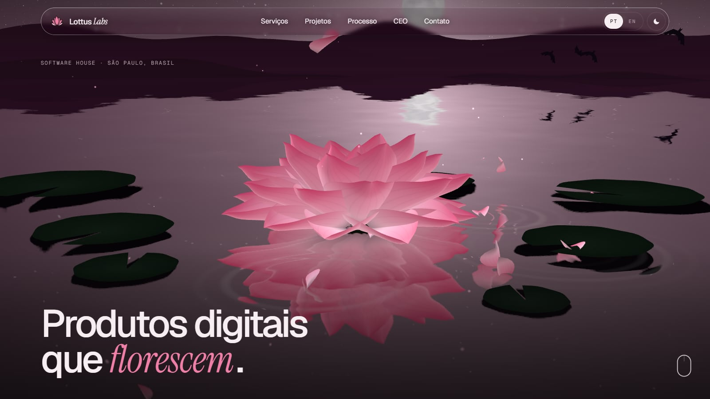

 

## Sobre a Lottus Labs

A **Lottus Labs** é a minha empresa: uma software house de São Paulo que cria produtos digitais sob medida, do primeiro rascunho até o site ou sistema publicado e funcionando.

Hoje a gente trabalha com três frentes:

- **Landing pages**: páginas rápidas e marcantes, com animações que contam a história da marca e levam o visitante até o contato.
- **Sistemas web**: painéis, portais e ferramentas internas que automatizam processos, organizam dados e conversam com os sistemas que o cliente já usa.
- **Plataformas SaaS**: produtos completos, com login, planos, pagamentos e várias empresas na mesma base, prontos para crescer.

O nome vem da flor de lótus, que nasce na lama e floresce limpa, acima da água. É assim que a gente encara cada projeto: ideias bagunçadas, prazos apertados e sistemas confusos viram produtos claros, bonitos e fáceis de usar. Nada de templates prontos: cada projeto é desenhado e desenvolvido do zero, para aquele cliente.

 

## Sobre o site

Este é o site oficial da Lottus Labs. Ele é o cartão de visitas da empresa e, ao mesmo tempo, a primeira prova do trabalho: em vez de só dizer o que a gente sabe fazer, o site mostra.

Tudo gira em torno de uma **flor de lótus em 3D**, flutuando num lago: numa manhã de sol no tema claro e sob a lua cheia no escuro. Conforme a pessoa rola a página, a câmera dá a volta na flor, as pétalas caem na água e formam ondas, os projetos aparecem em cartões curvos, o processo de trabalho se desenha como um rio e, no final, o nome Lottus é pintado com tinta na tela.

Por trás do visual, o objetivo é bem prático: apresentar os serviços, mostrar projetos reais, explicar como o trabalho acontece, apresentar quem está por trás da empresa e levar o visitante a chamar no WhatsApp ou no Instagram.

O site tem versão em **português e inglês**, **tema claro e escuro**, e foi pensado para ficar bonito e proporcional **do celular ao monitor grande**.

 

## Um passeio pelo site

### 1. A abertura

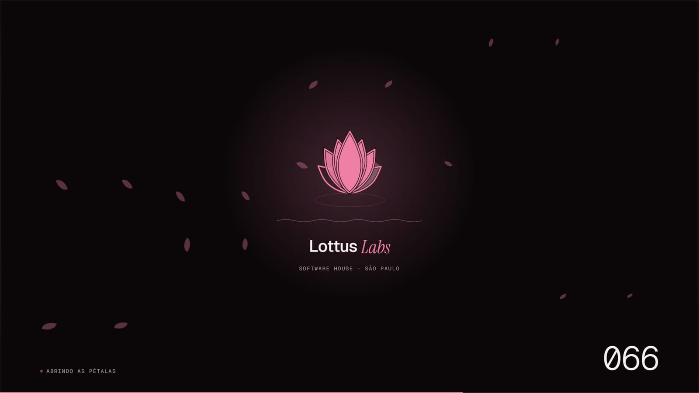

Enquanto o site carrega, uma flor de lótus se desenha no centro da tela e vai abrindo as pétalas conforme as coisas ficam prontas. O contador no canto acompanha o carregamento de verdade. No final, a flor floresce de vez, solta uma chuva de pétalas e a tela se abre em círculo, revelando o lago.

### 2. O lago

A primeira tela é o lago com a flor de lótus, nenúfares, montanhas ao fundo e o reflexo de tudo na água. De dia, o sol aparece atrás do morro; à noite, é a lua cheia que nasce ali e se reflete no lago. A flor é interativa: passando o mouse por ela, as pétalas se soltam, voam e caem na água, criando ondas que se espalham pelo reflexo. No celular, basta tocar na flor. Mesmo parada, a cena continua viva, com pétalas caindo devagar como flores de cerejeira, um bando de pássaros por vez cruzando o céu de dia e, à noite, vagalumes e alguns morcegos voando baixo sobre a água. Quem fica um pouco mais por ali ainda encontra alguns visitantes escondidos (veja [Detalhes ocultos](#detalhes-ocultos)).

### 3. Manifesto em 360°

<table>
  <tr>
    <td width="50%">
      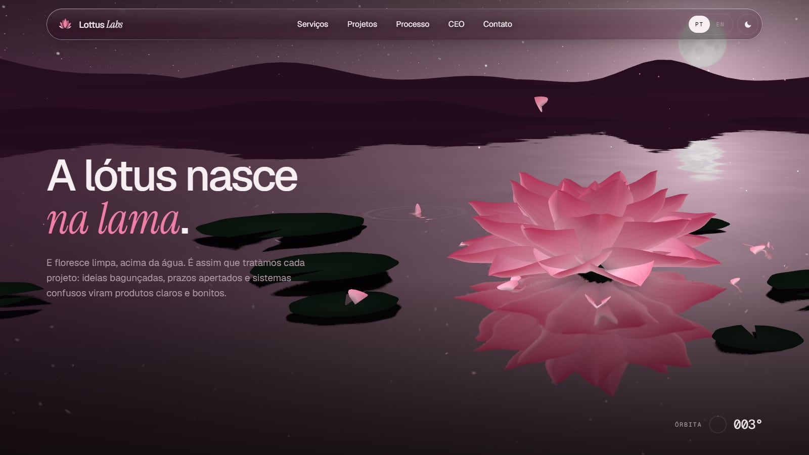
      
<b>A lótus nasce na lama</b> O começo da volta ao redor da flor

    </td>
    <td width="50%">
      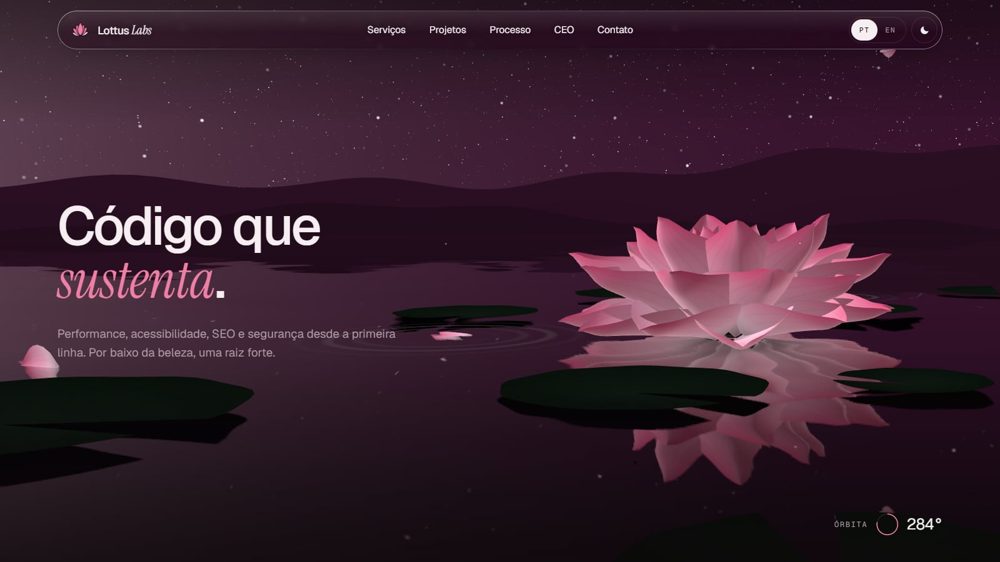
      
<b>Código que sustenta</b> A câmera já deu mais de meia volta

    </td>
  </tr>
</table>

Ao rolar, a câmera dá uma volta completa ao redor da flor enquanto quatro frases apresentam o jeito Lottus de trabalhar: *A lótus nasce na lama*, *Design com propósito*, *Código que sustenta* e *Feito para crescer*. Um pequeno marcador no canto mostra quantos graus da volta já foram percorridos.

### 4. O que a gente faz

<table>
  <tr>
    <td width="50%">
      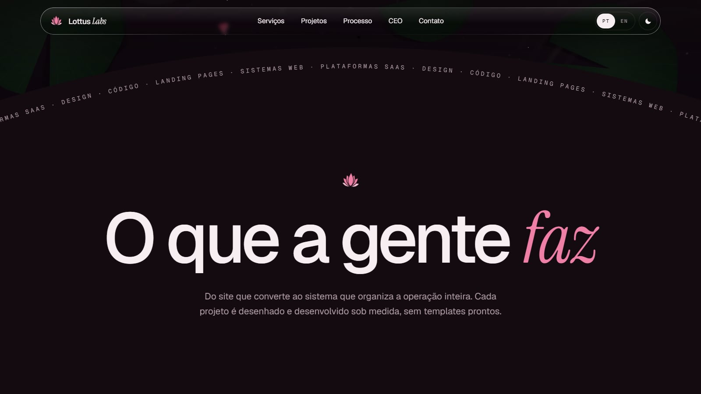
      
<b>O arco</b> Sobe por cima do lago, com os serviços girando na borda

    </td>
    <td width="50%">
      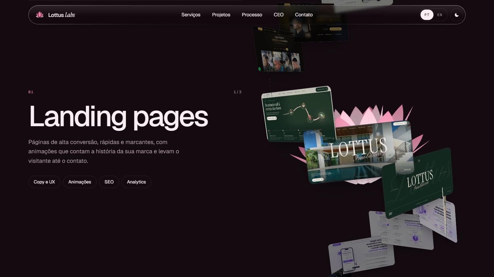
      
<b>A espiral de projetos</b> Gira com a rolagem (ou arrastando), em volta de uma lótus

    </td>
  </tr>
</table>

Um grande arco sobe por cima do lago, com o nome dos serviços correndo pela borda. Depois, cada serviço (landing pages, sistemas web e plataformas SaaS) aparece ao lado de uma espiral 3D feita com prints de projetos reais, que gira conforme a pessoa rola e traz um projeto para a frente em cada serviço. No centro dela, uma flor de lótus gira junto com os prints, e dá para girar a espiral à mão, arrastando com o mouse ou com o dedo. Os selos de cada serviço ganham cor, brilho e uma chuvinha de pétalas ao passar o mouse.

### 5. Trabalhos selecionados

<table>
  <tr>
    <td width="50%">
      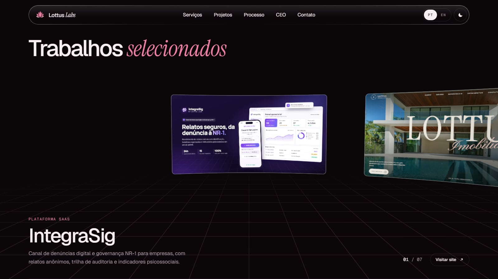
      
<b>IntegraSig</b> Os cartões passam um a um com a rolagem; clicar abre o site

    </td>
    <td width="50%">
      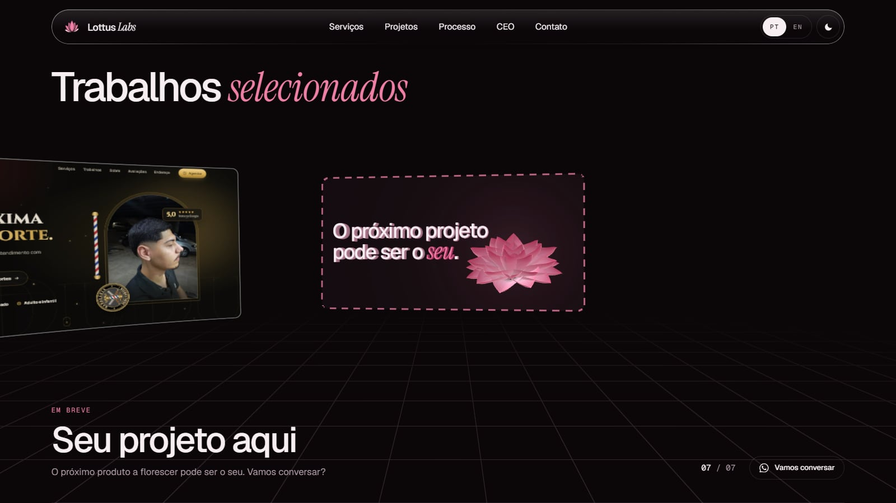
      
<b>O próximo pode ser o seu</b> O último lugar é um convite em 3D

    </td>
  </tr>
</table>

Os projetos aparecem em cartões curvos, como se estivessem numa parede circular ao redor de quem visita. A rolagem passa de um projeto para o outro, os cartões se curvam com a velocidade do movimento e clicar em um deles abre o site de verdade. No celular, também dá para passar os cartões arrastando o dedo para o lado.

O último lugar não é mais um cartão: é um convite em 3D, do mesmo tamanho, dentro de uma moldura tracejada. A frase *O próximo projeto pode ser o seu* aparece em letras com volume, que balançam devagar, e ao lado a lótus da marca se abre quando o convite chega ao centro. Para conversar, o botão *Vamos conversar*, logo abaixo, abre o WhatsApp.

### 6. Como a gente trabalha

<table>
  <tr>
    <td width="50%">
      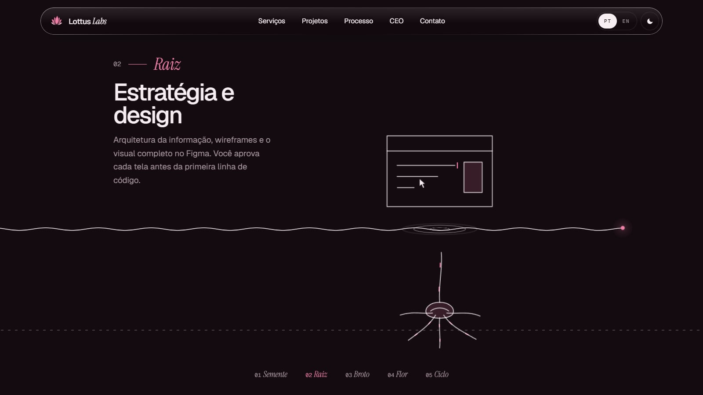
      
<b>Raiz · Estratégia e design</b> Cada etapa se desenha quando chega a sua vez

    </td>
    <td width="50%">
      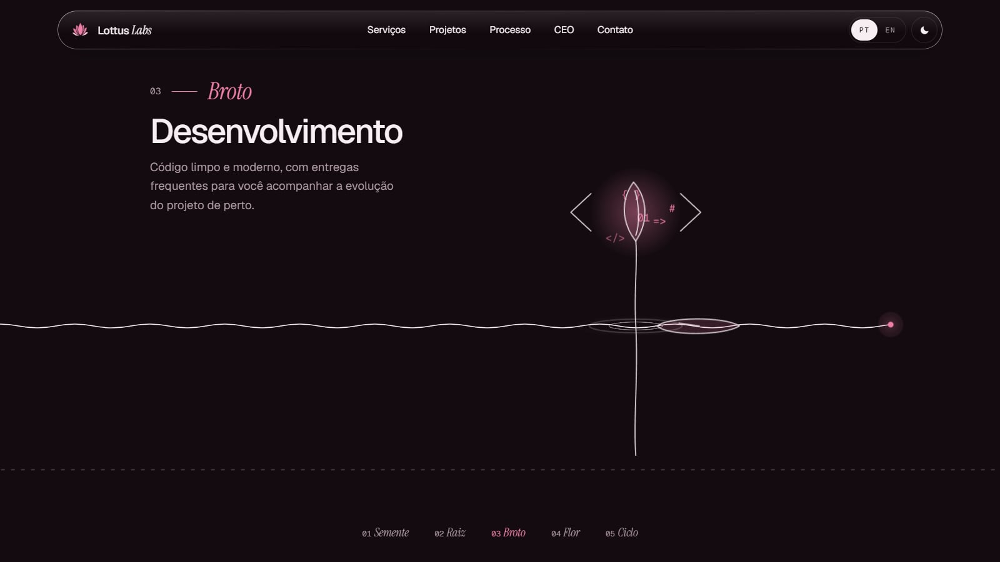
      
<b>Broto · Desenvolvimento</b> Um rio contínuo liga todas as etapas

    </td>
  </tr>
</table>

O processo é contado como o ciclo de vida da lótus, em cinco etapas: **Semente** (descoberta), **Raiz** (estratégia e design), **Broto** (desenvolvimento), **Flor** (lançamento) e **Ciclo** (evolução). A página corre para o lado enquanto uma caneta desenha um rio contínuo pela tela. Cada etapa se desenha à mão quando chega a sua vez e, depois de pronta, continua viva, com bolhas, brotos que balançam e pétalas caindo.

### 7. Quem é o CEO

<table>
  <tr>
    <td width="50%">
      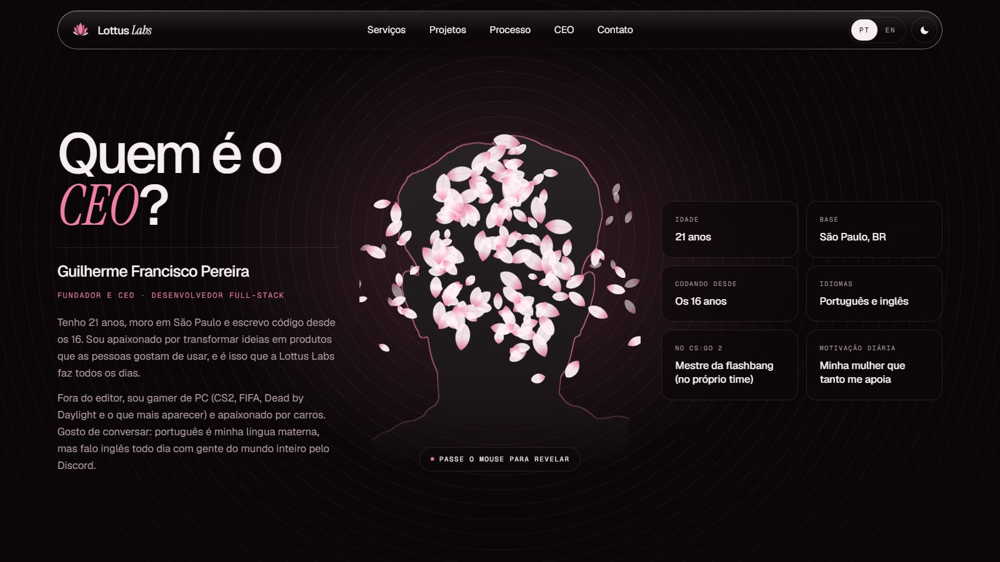
      
<b>A silhueta</b> O rosto fica escondido sob as pétalas

    </td>
    <td width="50%">
      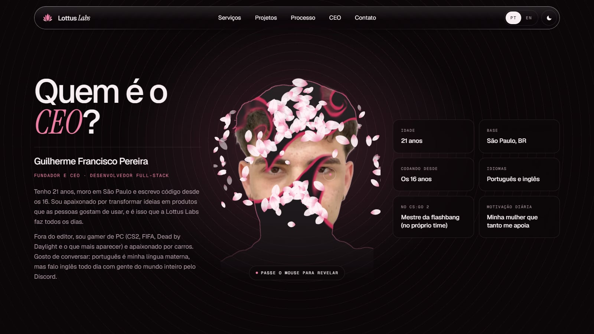
      
<b>Revelando a foto</b> O cursor joga tinta e as pétalas saem do caminho

    </td>
  </tr>
</table>

A apresentação do fundador (eu!). A foto fica escondida atrás de uma silhueta coberta de pétalas, com outras pétalas girando ao redor. Passando o mouse, o cursor joga tinta que revela a foto por baixo: a tinta escorre, seca sozinha em menos de um segundo, e as pétalas escorregam para fora dela e voltam quando ela seca. Ao lado, alguns fatos rápidos, como idade, cidade, idiomas e a motivação de todo dia.

### 8. Perguntas frequentes

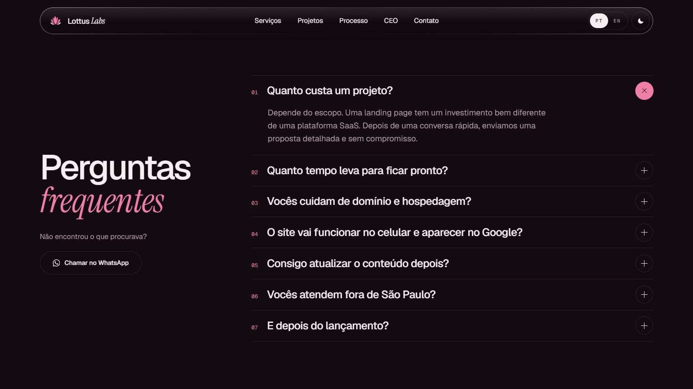

As dúvidas mais comuns respondidas de forma direta: quanto custa, quanto tempo leva, domínio e hospedagem, celular e Google, atualizações depois da entrega, atendimento fora de São Paulo e o que acontece depois do lançamento. Para o que não estiver ali, um botão leva direto ao WhatsApp.

### 9. Contato

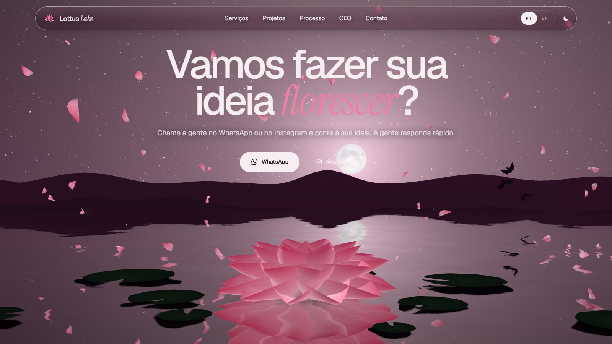

Assim que a seção aparece, começa uma chuva leve de pétalas sobre o lago. Com a rolagem, as pétalas se juntam e formam uma flor de lótus sobre a água, logo abaixo do convite *Vamos fazer sua ideia florescer?*, com botões diretos para o WhatsApp e o Instagram. O lago aqui é o mesmo do início, então os pássaros, os morcegos e os visitantes escondidos também passam por lá.

### 10. O final

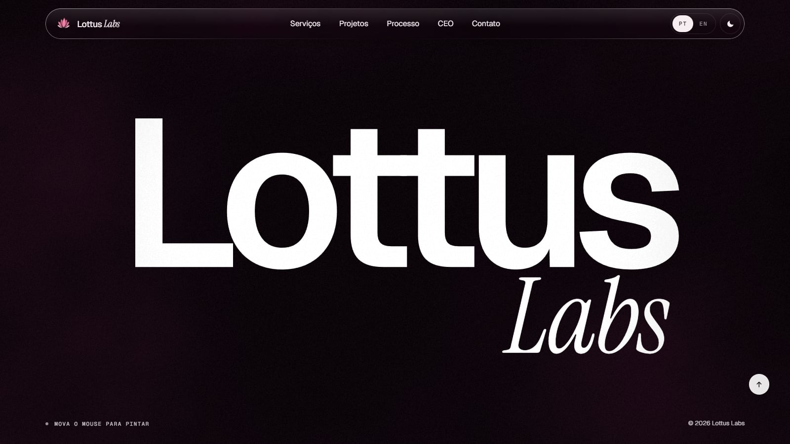

Para fechar, o nome **Lottus Labs** é pintado na tela por um pincel invisível. Depois, quem visita pode pintar por cima com o mouse ou com o dedo, e cada nova pincelada revela uma arte diferente por baixo das letras. Ao chegar ao fim da página, aparece um botão discreto para voltar ao topo.

 

## No celular

Boa parte das visitas chega pelo Instagram, então o site foi ajustado com cuidado para o celular.

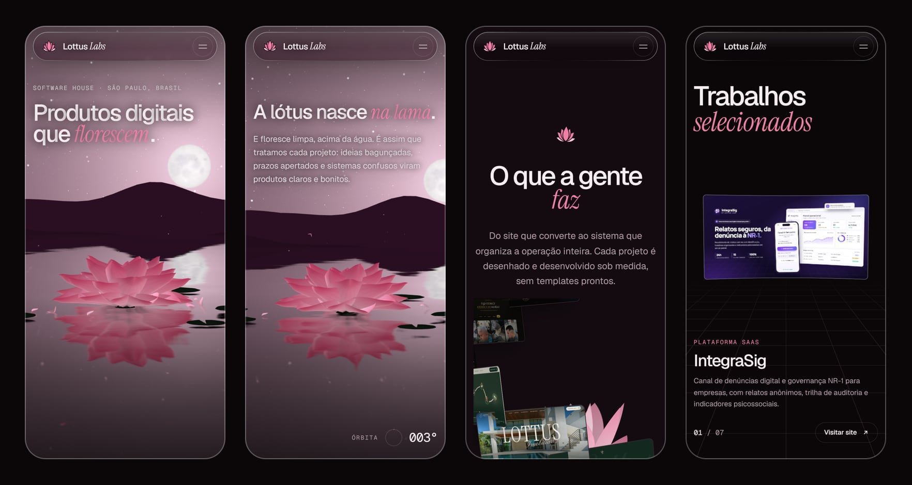

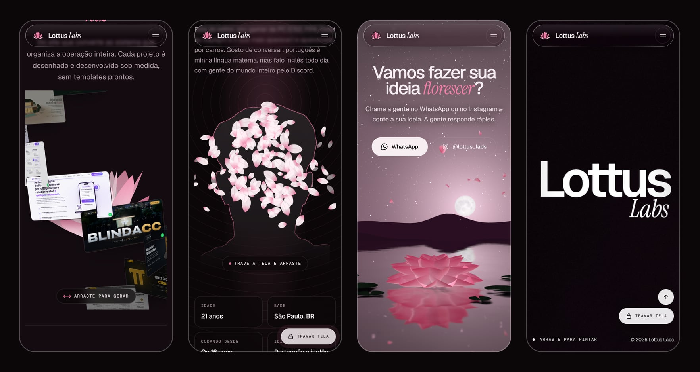

- **O título vem primeiro** e a flor fica logo abaixo, um pouco depois do meio da tela, também durante a volta de 360°.
- **A espiral de projetos vem antes dos serviços**, centralizada, e gira enquanto cruza a tela, abrindo com os prints da Lottus Imobiliária e sempre com uma foto de frente.
- **Botão “Travar tela”**: na foto do CEO e no final do site, um botão no canto segura a página para que dê para arrastar o dedo e revelar a foto ou pintar o nome, como se faz com o mouse no computador. Na foto, o dedo já revela o rosto mesmo sem travar.
- **Acompanha a barra do navegador**: as telas se ajustam quando a barra do iPhone aparece e some, sempre ocupando a tela inteira.
- **Detalhes pensados para o toque**: os selos dos serviços sempre cabem numa linha só, a espiral e os cartões de projetos giram com o dedo, e o atalho para o WhatsApp aparece logo depois da última pergunta frequente.
- **Textos legíveis sobre o céu**: no tema escuro, o título e as frases da volta de 360° ganham uma sombra suave para não sumirem no brilho da lua.

 

## Claro, escuro e em dois idiomas

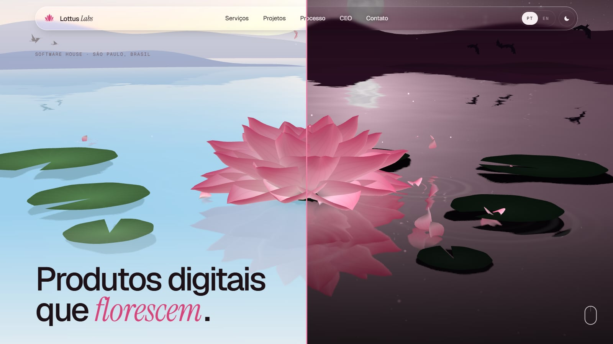

<table>
  <tr>
    <td width="50%">
      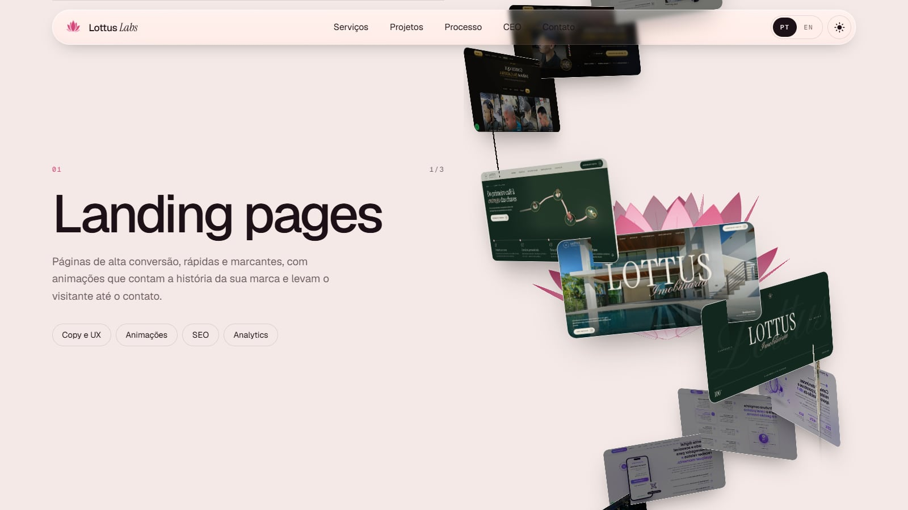
      
<b>Tema claro</b> Mesma experiência, com o lago numa manhã de sol

    </td>
    <td width="50%">
      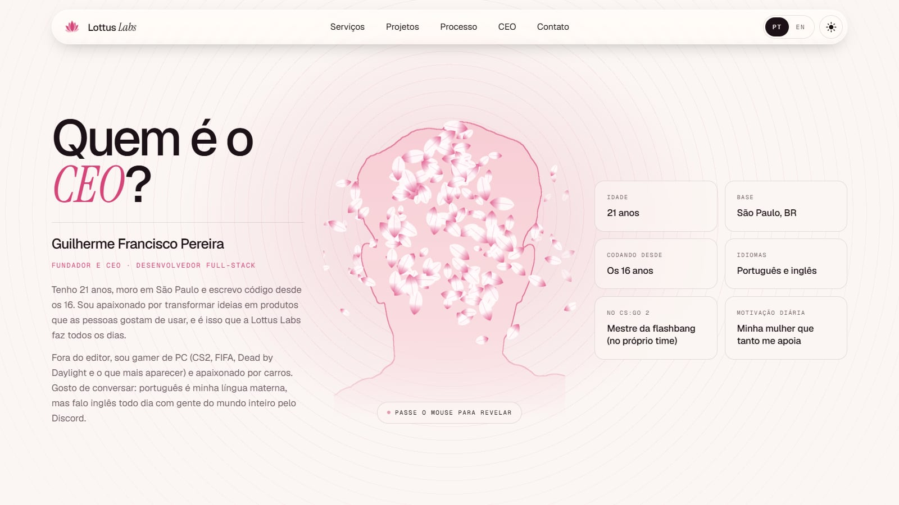
      
<b>Quem é o CEO, no claro</b> As cores da cena 3D também mudam com o tema

    </td>
  </tr>
  <tr>
    <td width="50%">
      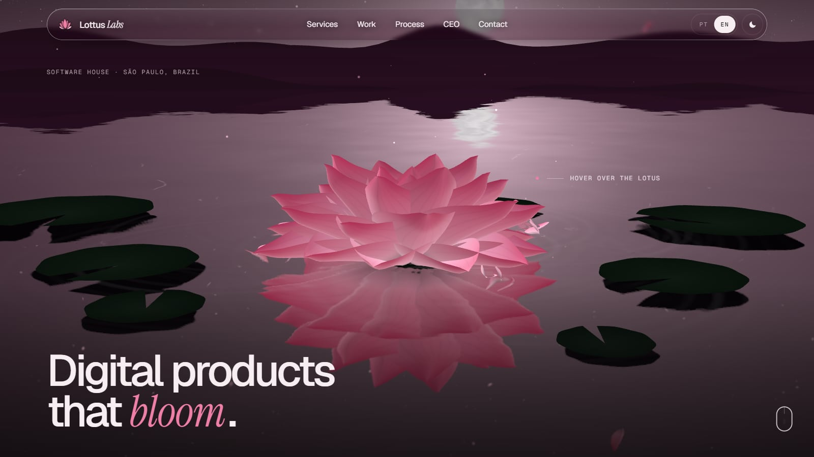
      
<b>Versão em inglês</b> “Digital products that bloom.”

    </td>
    <td width="50%">
      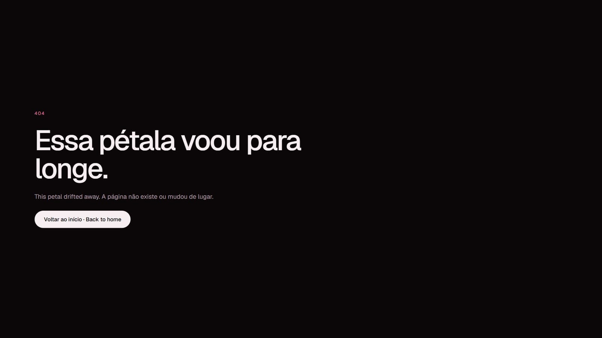
      
<b>Página 404 temática</b> “Essa pétala voou para longe.”

    </td>
  </tr>
</table>

- O tema segue a preferência do aparelho e pode ser trocado a qualquer momento no botão do topo. A troca acontece num círculo que se abre a partir do botão, e a cena 3D muda de cor suavemente, do dia de sol para a noite de lua. Até os bichos acompanham: os pássaros que estão na tela viram morcegos numa fumacinha, e voltam a ser pássaros quando amanhece.
- O final também acompanha o tema: no claro, o nome é pintado em tinta escura sobre um fundo claro, e as artes reveladas pelo pincel ganham versões de dia.
- O idioma é escolhido automaticamente pelo idioma do navegador e pode ser trocado no topo; a escolha fica salva para a próxima visita.

 

## Detalhes ocultos

Quem fica um tempo olhando o lago encontra alguns visitantes que não aparecem em nenhum menu. Eles surgem sozinhos, de vez em quando, sempre perto dos cantos da tela e longe dos textos, para não atrapalhar a leitura. Aparecem no lago do início, durante a volta de 360° e na seção de contato, no computador e no celular.

- Só um visitante aparece por vez, e o lugar é sorteado a cada visita.
- Se o tema mudar no meio de uma visita, o visitante vai embora na hora.
- Para quem ativou a opção “reduzir movimento” do sistema, eles não aparecem.

E quem conhece um certo código de videogame encontra mais uma surpresa: veja [O código secreto](#o-código-secreto-konami-code).

### Pássaros que viram morcegos

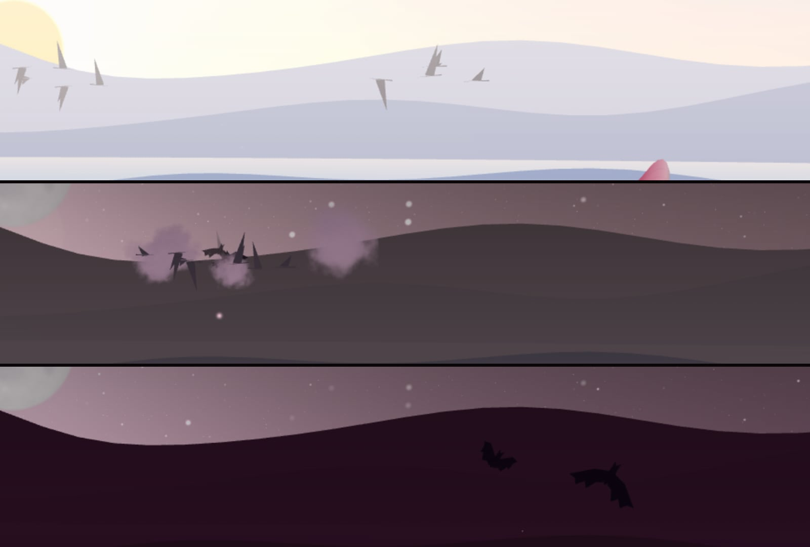

De cima para baixo: os pássaros de dia, a fumacinha da troca e os morcegos à noite

De dia, pequenos bandos de pássaros cruzam o céu em formação de V. À noite, quem voa são os morcegos, baixinho sobre o lago, em zigue-zague, sem nunca encostar na água. O céu nunca fica lotado: passa um bando de cada vez (às vezes dois se cruzam por um instante), e o próximo já entra pela lateral quando o anterior está indo embora, então ele também não fica vazio por mais de uns 2 segundos. Na hora em que o tema muda, cada pássaro que está na tela solta uma fumacinha e sai dela como morcego, um depois do outro, e vai aos poucos mudando o jeito de voar. Ao voltar para o tema claro, acontece o contrário.

- **Quando aparece**: sempre que o tema é trocado no botão do topo.

### O Drácula (só à noite)

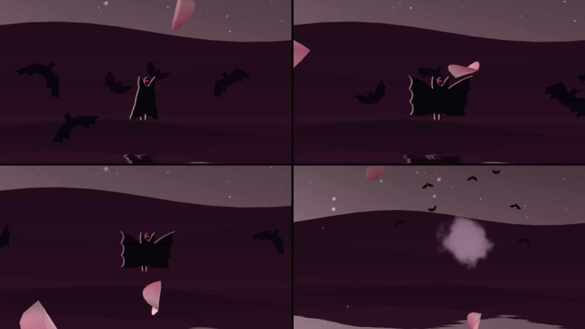

Da esquerda para a direita, de cima para baixo: ele surge, abre a capa, levanta voo e vira um bando de morcegos

Um conde pequenino, de capa e gola alta, surge devagar de trás de um morro e fica olhando o lago com olhos vermelhos, quase escondido no escuro. Depois de alguns segundos ele abre a capa como se fossem asas, levanta voo e, logo no comecinho do voo, gira no ar e some numa fumaça, de onde saem sete morcegos que se espalham pela noite, em direção à lua quando ela está por perto.

- **Quando aparece**: a primeira visita vem uns 4 segundos depois de escurecer e, depois disso, uma a cada 14 a 24 segundos.
- **Onde**: no alto dos morros, sempre perto de um dos lados da tela.

### A carpa (só de dia)

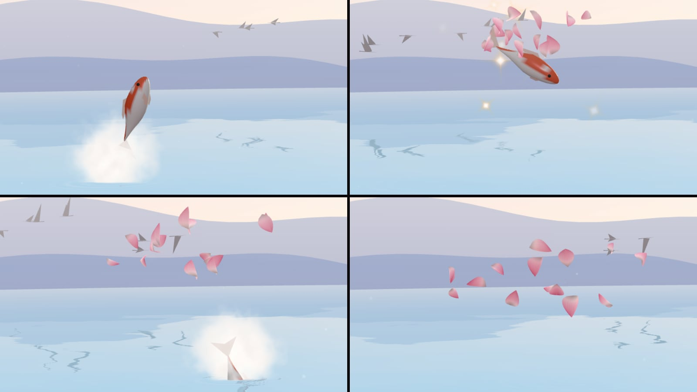

Da esquerda para a direita, de cima para baixo: o salto, as pétalas no alto, o mergulho e as pétalas caindo

A água começa a ondular perto de um canto da tela e, de repente, uma carpa koi salta do lago com um respingo. No alto do salto ela solta um punhado de pétalas de lótus e alguns brilhos dourados, depois mergulha de cabeça de volta na água, e as pétalas descem devagar até boiar sobre as ondas.

### A garça (só de dia)

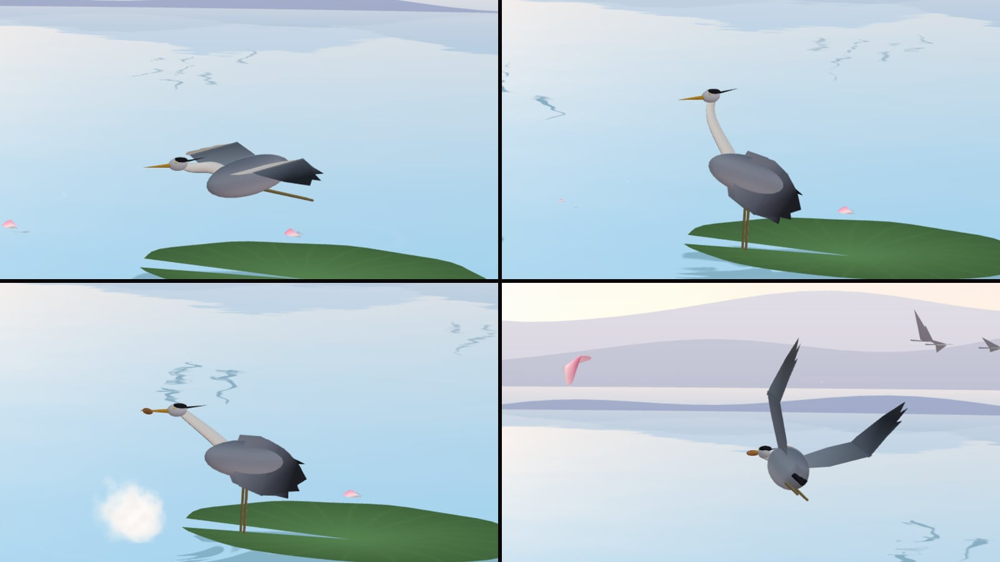

Da esquerda para a direita, de cima para baixo: a chegada, a espera, o peixe no bico e a partida

Uma garça-cinzenta chega batendo as asas, plana até uma folha de lótus perto de um canto e pousa freando com as asas e esticando as pernas. Ela fecha as asas, olha em volta, espreita a água com o pescoço esticado e dá um bote rápido: sobe com um peixinho se debatendo no bico. Depois agacha, levanta voo, faz a curva e vai embora por onde veio.

- **Quando aparecem (carpa e garça)**: as duas se revezam. A primeira chega uns 6 segundos depois de amanhecer e, depois disso, uma a cada 14 a 24 segundos, sempre depois que a anterior foi embora.
- **Onde**: em água livre ou numa folha de lótus perto dos cantos, longe da flor do meio e dos textos.

### O código secreto (Konami Code)

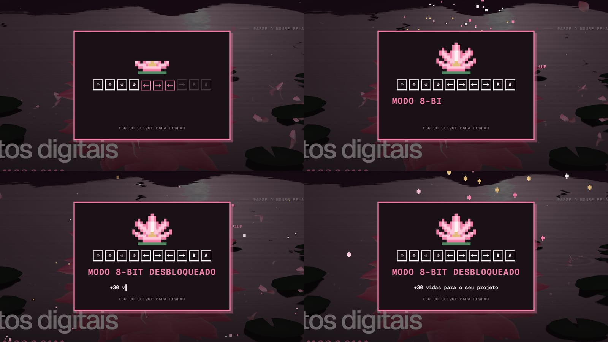

Da esquerda para a direita, de cima para baixo: as teclas acendem, a lótus de pixels se forma, a mensagem é digitada e as pétalas de pixel caem

Uma homenagem ao código mais famoso dos videogames. Ao digitá-lo, a tela ganha linhas de TV antiga e um cartão liga como um tubo de imagem: as teclas do código acendem uma a uma, uma lótus de pixels se desenha de baixo para cima e explode em pétalas quadradinhas, enquanto a mensagem *Modo 8-bit desbloqueado · +30 vidas para o seu projeto* é digitada letra por letra. Alguns “1UP” sobem pela tela e uma chuva de pétalas de pixel cai por alguns segundos. Tudo some sozinho em uns 7 segundos, ou antes, com Esc, um clique ou um toque.

- **Como ativar no computador**: digitar ↑ ↑ ↓ ↓ ← → ← → B A, em qualquer parte do site.
- **Como ativar no celular**: deslizar o dedo para cima, cima, baixo, baixo, esquerda, direita, esquerda, direita e depois tocar duas vezes na tela (o B e o A).
- **Para quem usa leitor de tela**: a mensagem também é anunciada. Com “reduzir movimento” ativado, o cartão aparece já pronto, sem animação.

 

## Destaques

- **Cena 3D feita sob medida**: flor de lótus, lago com reflexo de verdade, nenúfares, montanhas, sol e pássaros de dia, lua cheia, estrelas, vagalumes e morcegos à noite. Nada de imagens prontas.
- **Detalhes escondidos**: um Drácula que vira um bando de morcegos, uma carpa que salta do lago e uma garça que vem pescar aparecem de vez em quando, sem aviso, e o Konami Code destrava um modo 8-bit (veja [Detalhes ocultos](#detalhes-ocultos)).
- **Topo de vidro**: o menu fica sempre à vista, numa barra de vidro quase transparente que deixa ver a cena passando por trás.
- **Interativa de verdade**: as pétalas reagem ao mouse e ao toque, caem na água e formam ondas no reflexo.
- **Rolagem com cara de filme**: a câmera gira ao redor da flor, as seções se encaixam umas nas outras e cada movimento acompanha a rolagem. Os títulos florescem ao aparecer: as letras sobem e se abrem como pétalas.
- **Abertura honesta**: a flor da abertura acompanha o carregamento real do site, e as cenas 3D já ficam prontas antes de a página aparecer, para nada surgir vazio.
- **Proporcional em qualquer tela**: o mesmo visual do notebook ao monitor grande, sem ficar pequeno nem estourar a tela.
- **Logo vivo**: a flor do logo respira, balança e abre as pétalas ao passar o mouse, e só se anima quando está visível.
- **Microinterações**: cursor personalizado, chuva de pétalas dentro dos botões, selos que acendem e cartões que reagem ao movimento.
- **Acessível**: respeita a opção “reduzir movimento” do sistema, funciona com o teclado e tem atalho para pular direto ao conteúdo.
- **Leve no que importa**: a página aparece antes de qualquer coisa pesada; as cenas 3D começam a baixar logo depois, são montadas uma de cada vez e pausam quando saem da tela. No celular, os prints dos projetos vêm em tamanho de celular, e as fotos da espiral só carregam depois da abertura, porque ficam várias telas abaixo.
- **Pronto para o Google e para compartilhar**: prévia leve e bonita no WhatsApp e nas redes sociais, dados estruturados para o Google (a empresa, os serviços e as perguntas frequentes), mapa do site, versões em português e inglês ligadas entre si e ícones próprios, inclusive para salvar na tela do celular.

 

## Projetos em destaque

Alguns dos trabalhos que aparecem no site:

| Projeto | O que é | Link |
| --- | --- | --- |
| **IntegraSig** | Plataforma SaaS de canal de denúncias digital e governança NR-1 para empresas, com relatos anônimos, trilha de auditoria e indicadores psicossociais. | [Visitar](https://integrasig.com.br/landing-page) |
| **Lottus Imobiliária** | Site imobiliário de alto padrão em São Paulo, com vitrine de imóveis e uma experiência editorial elegante. | [Visitar](https://lottus-imobiliaria.vercel.app/) |
| **Blindalt** | Blindagem arquitetônica com um teste balístico em 3D: o visitante rola a página e vê o projétil se desfazer no vidro. | [Visitar](https://blindalt.vercel.app/) |
| **Duetto** | Agência de publicidade full service, com tipografia em 3D, o método em quatro tempos e contato direto pelo WhatsApp. | [Visitar](https://duetto-nine.vercel.app/) |
| **João Carvalho** | Relógios de luxo com procedência: com a rolagem, um relógio se desmonta peça por peça em 3D, e cada modelo ganha uma sala só dele. | [Visitar](https://junior-carvalho.vercel.app/) |
| **R&R Pavers Group** | Empresa de pavers e áreas externas em Tampa Bay, nos Estados Unidos, com antes e depois para arrastar, galeria de obras e orçamento grátis. | [Visitar](https://rer-pavers-group.vercel.app/) |
| **Vitória Rossini** | Página pessoal de uma futura fisioterapeuta, com a jornada acadêmica e uma contagem regressiva para a formatura. | [Visitar](https://vitoria-rossini.vercel.app/) |
| **Dudu Cortes** | Barbearia em Itu/SP com agendamento pelo WhatsApp, galeria de cortes e avaliações dos clientes. | [Visitar](https://dudu-cortes.vercel.app/) |

 

## Identidade visual

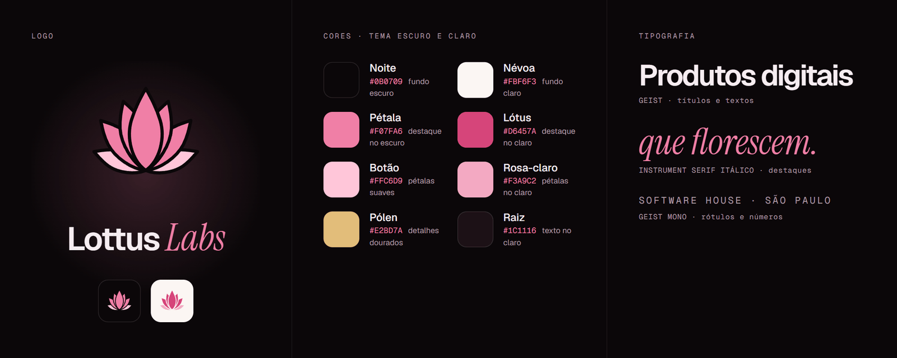

- **Logo**: uma flor de lótus de sete pétalas que se abrem a partir do mesmo ponto, como a flor do lago. A mesma forma aparece na abertura, no topo do site, nos cartões e nas pétalas que caem.
- **Cores**: o rosa da lótus em destaque, sobre um fundo quase preto à noite ou um off-white rosado de dia, com toques dourados de pólen.
- **Tipografia**: Geist nos títulos e textos, Instrument Serif em itálico para as palavras de destaque (como *florescem*) e Geist Mono nos rótulos e números.

 

## Tecnologias

      

| Parte do site | Feita com |
| --- | --- |
| Estrutura e páginas | Next.js e React, com TypeScript |
| Cenas 3D (lago, flor, pétalas, cartões e tinta) | Three.js |
| Animações e rolagem suave | GSAP e Lenis |
| Visual e temas | Tailwind CSS |
| Hospedagem | Vercel |

 

## Código-fonte

> [!NOTE]
> O código-fonte deste projeto é **privado**. Este repositório serve apenas como apresentação do trabalho.

 

## Fale com a gente

Tem uma ideia que precisa florescer?

- **Site**: [lottus-labs.com.br](https://lottus-labs.com.br)
- **Instagram**: [@lottus_labs](https://www.instagram.com/lottus_labs/)
- **WhatsApp**: [(11) 99785-7753](https://wa.me/5511997857753)

 

## Direitos

O nome, a marca, o logo, os textos e as imagens da **Lottus Labs** pertencem à empresa. Os prints dos projetos exibidos pertencem aos respectivos clientes. Todos os direitos reservados: não é permitido reproduzir ou reutilizar este conteúdo sem autorização.

<!-- Desenvolvido por: Guilherme Francisco Pereira, fundador e CEO da Lottus Labs -->

> Feito com 🪷 em São Paulo, por Guilherme Francisco Pereira.

